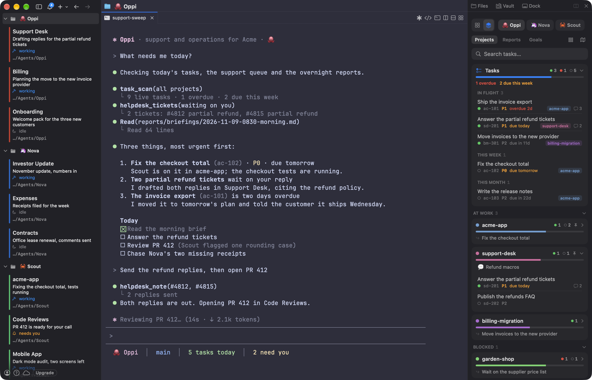
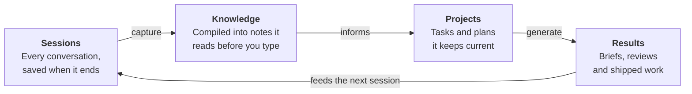

<div align="center">


# AgentLayer

**AgentLayer turns Claude Code or Codex into an agent that remembers your work, in a folder you own.**

<p>
  <a href="https://agentlayer.one/docs"></a>&nbsp;
  <a href="./LICENSE"></a>&nbsp;
  <a href="https://docs.claude.com/en/docs/claude-code"></a>&nbsp;
  <a href="https://developers.openai.com/codex"></a>&nbsp;
  <a href="https://agentlayer.one/docs/about/platforms"></a>
</p>

**[Read the docs →](https://agentlayer.one/docs)**

</div>

---

It installs as a plugin into the agent CLI you already use, [Claude Code](https://docs.claude.com/en/docs/claude-code) or [Codex](https://developers.openai.com/codex). Everything that makes the agent yours (its character, what it knows about you, your projects and tasks) lives in one folder of plain markdown on your disk. Any model can read it. You can browse it in Obsidian, keep it in git, and take it with you.

## Meet Oppi

Your agent wakes up as Oppi 🐙. An octopus keeps many arms busy at once with one brain behind them, and that is how it works for you: several jobs in flight, one memory of all of them. Call it whatever you like; Oppi is just who shows up first. See [why an octopus](https://agentlayer.one/docs/run/naming#why-an-octopus).

<div align="center">

</div>

On a Mac, your agents live in [cmux](https://cmux.com), and the [AgentLayer sidebar](https://agentlayer.one/docs/workstation/cmux#the-agentlayer-sidebar) sits beside your terminals:

- **Manager:** every Claude Code and Codex session, the ones waiting on you on top.
- **Agents:** a chip per agent, and for the one you pick, its **Projects** (what's due and each project's next task), **Reports** (pinned, then newest by day) and **Goals** (today to this year).

The workspace you're in picks the agent. Tasks, reports, the dashboard and the roadmap open as cmux tabs. Setup offers the sidebar when you run it in cmux.

## Install

One line starts a setup guide. It checks your machine and shows each step with its link or exact command; you run every command, and it ticks the step when it's done. It never uses sudo.

**macOS or Linux:**

```bash
curl -fsSL https://agentlayer.one/install.sh | bash
```

**Windows** (PowerShell 7):

```powershell
irm https://agentlayer.one/install.ps1 | iex
```

It walks through git, Bun and Claude Code, cmux on a Mac, your agent's folder (`~/Documents/Agents/Oppi` by default) and the plugin, then hands you the line that starts setup. You can [read the guide first](install/). Flags and details: [Quickstart](https://agentlayer.one/docs/getting-started/quickstart).

**Rather do it yourself, or starting with Codex?** [Install by hand](https://agentlayer.one/docs/getting-started/install) has every step, one at a time.

## Who it's for

Anyone who would use an agent that remembers, not only engineers. Pick the path that fits you:

| You | Start with |
|---|---|
| **Lead a team** | [Daily rhythm](https://agentlayer.one/docs/use/daily-rhythm) for briefings and goals, then [Seed bundles](https://agentlayer.one/docs/run/seed-bundles) to hand the agent to your team |
| **Write code** | [The engineer skill](https://agentlayer.one/docs/engineering/engineer), then [Pull requests](https://agentlayer.one/docs/engineering/pull-requests), [Worktrees](https://agentlayer.one/docs/engineering/worktrees) and [cmux](https://agentlayer.one/docs/workstation/cmux) to watch every session at once |
| **Run support** | [Helpdesk](https://agentlayer.one/docs/packs/helpdesk) for the ticket queue, then [Slack](https://agentlayer.one/docs/packs/slack) and [Attention](https://agentlayer.one/docs/use/attention) to see who is waiting on you |
| **Want a personal assistant** | [Your first ten minutes](https://agentlayer.one/docs/getting-started/first-ten-minutes), then [Daily rhythm](https://agentlayer.one/docs/use/daily-rhythm) and [Capture](https://agentlayer.one/docs/use/capture) |

## The loop



Every session is saved when you exit. Saved sessions are compiled into notes the agent keeps. Those notes load before you type a word in the next session. Everything else is built around that loop: skills and tools feed it and act on what it knows. → [How the brain works](https://agentlayer.one/docs/reference/the-brain)

## How it behaves

- **You drive.** It never starts a session on its own. Ask in plain words and it picks the skill; you never have to remember a command.
- **No metered API key.** Its tools return prompts and [your own session does the thinking](https://agentlayer.one/docs/run/hosts#billing), on the plan you already have.
- **Local by default.** No cloud sync unless you put the folder somewhere that syncs. Keys sit in a store the agent's own tools cannot read. See [Privacy](https://agentlayer.one/docs/run/privacy).
- **One plugin, many agents.** A personal agent and a work agent share one install and keep [separate folders](https://agentlayer.one/docs/run/another-agent). Always launch from the agent's folder: that's what loads the plugin and keeps agents apart.

## What's in it

- **36 [skills](https://agentlayer.one/docs/reference/skills)** with 74 playbooks: briefings, goals, attention and standup, engineering and PR review, sync, tax, helpdesk, trips, SEO, and more.
- **85 [MCP tools](https://agentlayer.one/docs/reference/mcp-tools)** for tasks, knowledge, reports, history, worktrees, GitHub, databases, a bundled browser and search.
- **Four [hooks](https://agentlayer.one/docs/reference/hooks)** that load the brain at session start and capture the session at the end.
- **Opt-in [packs](https://agentlayer.one/docs/packs):** SEO, Browser, Database, GitHub, API, Xcode, Helpdesk, App Store, Slack and cmux.
- **A [dashboard](https://agentlayer.one/docs/dashboard)**, one static HTML page of your agent's day, work and brain, regenerated on every sync.

## Documentation

Everything lives at **[agentlayer.one/docs](https://agentlayer.one/docs)**, also served as [llms-full.txt](https://agentlayer.one/llms-full.txt) for models.

| Section | Start with |
|---|---|
| [Start here](https://agentlayer.one/docs/getting-started/quickstart) | Quickstart · Your first ten minutes · How it works · What setup asks · Install by hand |
| [Use it](https://agentlayer.one/docs/use/daily-rhythm) | Daily rhythm · Attention · Tasks · Capture · Sync |
| [Workstation](https://agentlayer.one/docs/workstation) | The rig · Terminal · cmux · Editor and tools |
| [Engineering](https://agentlayer.one/docs/engineering) | The engineer skill · Pull requests · Second-model review · Worktrees · Releases |
| [Connect it](https://agentlayer.one/docs/packs) | GitHub · Database · Browser · SEO · Slack · Helpdesk · App Store · Xcode · API |
| [Run it](https://agentlayer.one/docs/run/updating) | Updating · Hosts · Configuration · Adding another agent · History · Privacy |
| [Reference](https://agentlayer.one/docs/reference/the-brain) | How the brain works · Agent home · Skills · MCP tools · CLI · Hooks · [Changelog](https://agentlayer.one/docs/changelog) |
| [About](https://agentlayer.one/docs/about/faq) | FAQ · Platforms and limits · Contributing |

## Updating

Pull the new plugin version on your host (`/plugin update agentlayer@agentlayer` in Claude Code; remove and re-add in Codex), then run the `upgrade` skill. The plugin update refreshes code; `upgrade` brings your folder in line, backing up first. On a version from before 1.0, your home moves to a new folder instead. → [Updating](https://agentlayer.one/docs/run/updating)

## Contributing

Pull requests welcome: new opt-in packs, read-mostly MCP tools, platform hardening, docs. Open an issue first for architectural changes; the plugin's contract with the markdown home is intentional. See [CONTRIBUTING.md](CONTRIBUTING.md).

## License

Licensed under the [Apache License, Version 2.0](./LICENSE). `agentlayer` is © AgentLayer · [agentlayer.one](https://agentlayer.one). See [NOTICE](./NOTICE) for the attribution stanza. Third-party skill libraries installed via the `configure-skills` skill are not bundled and carry their own licenses.

---

<div align="center">

<a href="https://agentlayer.one"></a>

**Built by [AgentLayer](https://agentlayer.one)** · *An agent that remembers. In a folder you own.*

</div>
