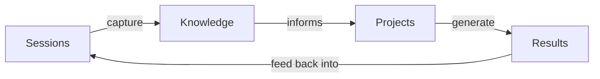

<div align="center">


# AgentLayer

**AgentLayer turns Claude Code or Codex into an agent that remembers your work, in a folder you own.**
One markdown folder, one plugin, a brain that learns who you are session after session.

<p>
  <a href="https://agentlayer.one/docs"></a>&nbsp;
  <a href="./LICENSE"></a>&nbsp;
  <a href="https://docs.claude.com/en/docs/claude-code"></a>&nbsp;
  <a href="https://developers.openai.com/codex"></a>&nbsp;
  <a href="https://agentlayer.one/docs/about/platforms"></a>&nbsp;
  <a href="https://agentlayer.one"></a>
</p>

**[Read the docs →](https://agentlayer.one/docs)**

</div>

---

## Meet Oppi

Meet Oppi 🐙, or Ops to its friends, which is also what it's for. An octopus keeps eight arms busy at once, and each arm does some of its own thinking: about two-thirds of its neurons sit in the arms. Its central brain still holds it all together. That's the agent: many jobs in flight, each handled with some independence, and one brain that remembers all of it. Octopuses are also among the cleverest animals around: they solve puzzles and use tools. Call your agent whatever you like; Oppi is just who shows up first.

## What is it?

AgentLayer is a free, open-source plugin for the agent CLI you already use, [Claude Code](https://docs.claude.com/en/docs/claude-code) or [OpenAI Codex](https://developers.openai.com/codex). Everything that makes your agent yours (personality, memory, knowledge, projects, tasks) lives in your own directory as plain markdown. Any AI can read it. You can browse it in Obsidian or Finder. If you ever want to leave, you take the folder and go.

What's in it:

- An **83-tool MCP server** for tasks, knowledge compilation, reports, home history, worktrees, database queries, GitHub review, search, page speed, a bundled browser, and Google Search Console.
- A **34-skill library**, related work grouped into one skill with playbooks (briefing, goals, SEO, attention, engineering), covering onboarding, version history, project lifecycle, a daily attention view with standup and a session radar, goals from the day to the year, morning and evening briefings, tax deadlines and bookkeeping, a support queue pulse and reply drafts, trip planning, worktree setup, API-request drafting, read-only SEO auditing, and audio and video transcripts and summaries.
- A **knowledge pipeline** that turns every conversation into structured, queryable memory.
- **Opt-in packs** (SEO, Browser, Database, GitHub, API, Xcode, Helpdesk, App Store, Slack) and a bridge to community skill libraries via [skills.sh](https://skills.sh).
- **You drive.** Ask in plain words and your agent picks the skill and playbook; nothing runs unasked, and you never have to remember a command.



Every session is captured on exit. Captured sessions compile into a wiki. The wiki loads before you type a word in the next session. Everything else is built around that loop.

## Quick start

You need **Bun ≥ 1.4.4**, **Git**, and a host: **Claude Code** or **Codex**. Full prerequisites, the local clone install, and Windows notes are in [Install by hand](https://agentlayer.one/docs/getting-started/install).

Pick a home for the brain, then install the plugin from it:

```bash
mkdir -p ~/Documents/Agents/Oppi && cd ~/Documents/Agents/Oppi
```

| Claude Code | Codex |
|---|---|
| `claude`, then `/plugin install agentlayer --marketplace AgentLayer1/agentlayer-agent-marketplace` | `codex plugin marketplace add AgentLayer1/agentlayer-agent-marketplace` then `codex plugin add agentlayer@agentlayer` |
| Relaunch and run `/agentlayer:init` | Create the home from Claude Code, then open it with `codex` and run `$upgrade` once |
| Skills: `/agentlayer:<skill>` | Skills: `$<skill>` |

Five minutes of questions later you have a home. See [What setup asks](https://agentlayer.one/docs/getting-started/onboarding) and [Hosts](https://agentlayer.one/docs/run/hosts).

**On a plugin version from before 1.0?** Your home moves to a new folder rather than updating in place: see [Updating](https://agentlayer.one/docs/run/updating).

**Want a head start?** The [wizard](https://agentlayer.one/engage#wizard) turns eleven prompts about your company into a seed bundle; hand the zip to `init` and the agent wakes up named, characterised, and briefed. A teammate's `seed export` does the same from an existing agent. → [Seed bundles](https://agentlayer.one/docs/run/seed-bundles)

**Always launch from the agent home.** The plugin loads only for sessions started there, and that is also what keeps several agents on one machine apart. Reach your code through `permissions.additionalDirectories` in the home's `.claude/settings.local.json` (init writes it there, since the path is this machine's), not by launching from a repo.

---

## Documentation

This README is the short version. Everything lives at **[agentlayer.one/docs](https://agentlayer.one/docs)**, also served as [llms-full.txt](https://agentlayer.one/llms-full.txt) for models.

| Section | Start with |
|---|---|
| [Start here](https://agentlayer.one/docs/getting-started/quickstart) | Quickstart · Your first ten minutes · How it works · What setup asks · Install by hand |
| [Use it](https://agentlayer.one/docs/use/daily-rhythm) | Daily rhythm · Plan and run · Build and ship · Reach and see · Brain and memory · Attention · Tasks · Capture · Sync |
| [Dashboard](https://agentlayer.one/docs/dashboard) | Today · Tasks and projects · Sessions · Brain · Reports and scheduler · Capabilities |
| [Engineering](https://agentlayer.one/docs/engineering) | The engineer skill · Principles · Pull requests · Second-model review · Worktrees · Verification · Releases |
| [Connect it](https://agentlayer.one/docs/packs) | GitHub · Database · Browser · SEO · Slack · Helpdesk · App Store · Xcode · API · Accounts and costs |
| [Run it](https://agentlayer.one/docs/run/updating) | Updating · Hosts · Claude Code · Codex · Configuration · Adding another agent · Billing per agent · History · Naming your agent · Privacy |
| [Reference](https://agentlayer.one/docs/reference/the-brain) | How the brain works · Agent home · Architecture · Skills · MCP tools · CLI · Hooks · Upgrades and releases · [Changelog](https://agentlayer.one/docs/changelog) |
| [Workstation](https://agentlayer.one/docs/workstation) | The rig · Terminal · cmux · Editor and tools |
| [About](https://agentlayer.one/docs/about/faq) | FAQ · Platforms and limits · Before the plugin · Contributing |

---

## Highlights

<div align="center">

</div>

- **Memory that compounds.** Hooks capture every session; the `knowledge-compile` skill distils them into user facets, concept articles, and active memory that load next launch. → [How the brain works](https://agentlayer.one/docs/reference/the-brain)
- **Projects, not just chats.** One markdown file per task with frontmatter, threads, and a generated dashboard. → [Tasks](https://agentlayer.one/docs/use/tasks)
- **An attention page for the day.** The `attention` skill keeps today to three, shows what carried over and what the roadmap has in flight, and the `goals` skill sets the day, week, month and year with you; one page for all your work and one per project. → [Daily rhythm](https://agentlayer.one/docs/use/daily-rhythm)
- **One pass to bring everything current.** The `sync` skill runs compile → lint → flywheel → dashboards and ends with a next move. → [Sync](https://agentlayer.one/docs/use/sync)
- **Every change can be undone.** The `history` skill turns on local version history for the home in one question, no git knowledge needed; sync saves a snapshot each run. A home in iCloud, Dropbox or OneDrive keeps its history in `~/.local/state` (`%LOCALAPPDATA%` on Windows), where syncing can't damage it. → [History](https://agentlayer.one/docs/run/history)
- **One dashboard page** regenerated on every sync, self-contained, zero external requests. → [Dashboard](https://agentlayer.one/docs/dashboard)
- **Engineering by playbook.** The `engineer` skill routes code work to a playbook (bug fix, feature, refactor, performance, forensics, prototype, and more) backed by 23 named principles, proves the result on the running artifact, and strips comments before you see the diff. → [Engineering](https://agentlayer.one/docs/engineering)
- **Pull requests, three ways.** Review a teammate's PR with verified findings and paste-ready comments, prep to present your own, or brief a second model on your branch and have its findings verified, fixed, and committed on one dossier. → [Pull requests](https://agentlayer.one/docs/engineering/pull-requests)
- **A sidebar in cmux, for every agent on your Mac.** If you use cmux, one native panel in its right sidebar shows the agent of the workspace you're in: who needs you, links to the dashboard's pages, its projects and pins, every agent's sessions, and plain-word requests typed into a new chat for you to send. Optional: `/agentlayer:configure-skills` → cmux.
- **Multiple homes, multiple personas.** One plugin install, separate brains, told apart by the launch folder. → [Adding another agent](https://agentlayer.one/docs/run/another-agent)
- **Hand an agent to a teammate.** A seed bundle carries persona, curated knowledge, and setup as its own copy; credentials travel as names only. → [Seed bundles](https://agentlayer.one/docs/run/seed-bundles)
- **Subscription-billed.** The MCP server returns prompts; your session does the thinking on your host's plan. → [Hosts](https://agentlayer.one/docs/run/hosts#billing)
- **Private by construction.** Secrets in a deny-gated store the agent cannot read, transcripts redacted before they persist. → [Privacy](https://agentlayer.one/docs/run/privacy)

---

## Updating

Pull the new plugin version on your host (`/plugin update agentlayer@agentlayer` in Claude Code; remove and re-add in Codex), then run the `upgrade` skill. The plugin update refreshes code; `upgrade` reconciles your home from the CHANGELOG's Upgrade blocks, backing up first. → [Updating](https://agentlayer.one/docs/run/updating) · [Upgrades and releases](https://agentlayer.one/docs/reference/upgrades)

---

## Contributing

Pull requests welcome: new opt-in packs, read-mostly MCP tools, platform hardening, docs. Open an issue first for architectural changes; the plugin's contract with the markdown home is intentional. See [CONTRIBUTING.md](CONTRIBUTING.md).

## License

Licensed under the [Apache License, Version 2.0](./LICENSE). `agentlayer` is © AgentLayer · [agentlayer.one](https://agentlayer.one). See [NOTICE](./NOTICE) for the attribution stanza. Third-party skill libraries installed via the `configure-skills` skill are not bundled and carry their own licenses.

---

<div align="center">

<a href="https://agentlayer.one"></a>

**Built by [AgentLayer](https://agentlayer.one)** · *An agent that remembers. In a folder you own.*

</div>
